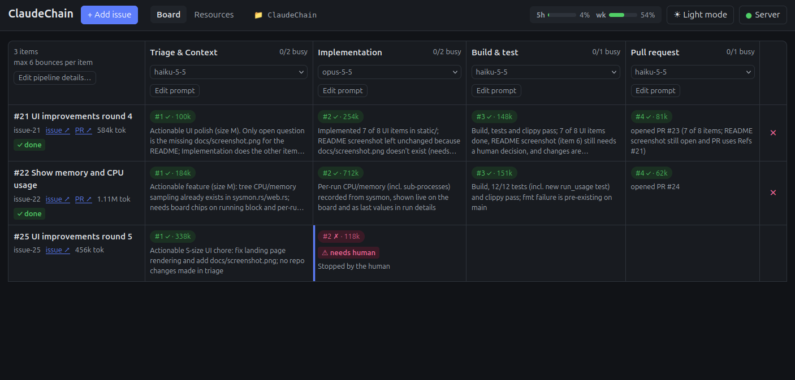

# ClaudeChain

A local web app that runs GitHub issues through a pipeline of Claude Code
agents, by default Triage & Context → Implementation → Build & test → Pull
request. Each step has its own prompt, model and worker limit, and steps can be
added from a list of preset stages in the pipeline editor. Agents talk
only through files, and each one decides where the work goes next: forward,
back to an earlier step, or to you.



## Requirements

- Rust, `git`, and `gh` (logged in).
- The [Claude Code](https://claude.com/claude-code) `claude` CLI, logged in.
  Agents always use this login (`ANTHROPIC_*` environment variables are
  removed), so with a subscription, runs count against your plan. Costs shown
  in the UI are API-equivalent estimates.

## Running

```bash
cargo run --release
```

Open http://127.0.0.1:7878 and pick a repository. By default its pipeline, prompts
and items are stored in `<repo>/.claudechain`, which is added to
`.git/info/exclude`. Recent repositories are remembered in
`~/.config/claudechain/state.json`.

Several repositories can be open at once, one per browser tab. The tab's
repository is in its URL (`?repo=<id>`), so tabs survive a reload and can be
bookmarked. Opening a repository switches only the current tab. Repositories
that no tab shows keep running their agents until the server stops. They all
share one Claude account, so its plan limits and pause threshold apply to the
agents of all open repositories together.

Options: `--repo <path>`, `--data <dir>`, `--port`, `--host`, `--claude <path>`.

## Using it

- **+ Add issue**: a GitHub issue URL, `#123`, or plain text.
- **Pipeline**: add, reorder and configure steps (model, thinking level,
  workers, approval, permission mode, tools, allowed transitions). The thinking
  level (`effort` in `pipeline.toml`: low, medium, high, xhigh or max) is passed
  to `claude --effort`; leave it unset for Claude's default. Column headers edit
  each step's model, thinking level and prompt. Setting
  workers to 0 pauses a step.
- **Click a cell** to inspect a run: live transcript, exact input, output files
  and the branch diff. From there you can chat with the agent: messages reach a
  running agent right away, and resume a finished run's session. You can also
  stop, retry, move or remove the item.
- **Row buttons** (far right of each item): ⏪ restarts the item from scratch
  (deletes its runs, messages, worktree and local branch, then queues it at the
  first step) and ✕ removes it from the board. Both stop a running agent first.
- **Resources**: plan usage and limits, an auto-pause threshold, token usage,
  and system load (Linux only).

## MCP server

ClaudeChain serves a basic [MCP](https://modelcontextprotocol.io) endpoint at
`/mcp` (Streamable HTTP, JSON responses), so an agent can watch and drive the
board. Add it to Claude Code with:

```bash
claude mcp add --transport http claudechain http://127.0.0.1:7878/mcp --header "X-ClaudeChain: 1"
```

The `X-ClaudeChain` header is required for every POST (see the cross-site
protection in `src/web.rs`). Tools: `list_repos`, `board` (text overview of
all items per step: status, iteration, last run, PR), `list_items`,
`list_steps`, `get_item`, `get_run_message`, `add_item`, `approve`,
`move_item`, `retry`, `stop` and `send_message`.

Every tool takes an optional `repo` argument (a repository id from
`list_repos`, its path or its directory name). Without it, `board` and
`list_items` cover all open repositories, item tools find the repository that
has the item, and `add_item`/`list_steps` work when exactly one repository is
open.

There is no authentication: anyone who can reach the server can run agents.
To use it from another machine, prefer an SSH tunnel
(`ssh -L 7878:127.0.0.1:7878 host`) over `--host 0.0.0.0`.

## How it works

```
<repo>/.claudechain/
  pipeline.toml        steps and their settings
  prompts/             general.md plus one prompt per step
  items/<id>/          issue.md, item.json, messages/, runs/
  worktrees/<id>/      git worktree on branch claudechain/<id>
  pipelines.json       this pipeline's name and the list of all pipelines
```

A repository can have several pipelines. Each is its own data directory in the
format above; the first one (`<repo>/.claudechain`) is called "Default". Use the
dropdown next to the repository name to switch, add a pipeline (pick or type a
new folder) or rename the current one. All pipelines of the open repository run
at the same time, so switching never interrupts agents; the dropdown shows how
many agents each one is running. Each pipeline has its own browser URL
(`?repo=<id>`), so different tabs can show different pipelines. Every pipeline's
`pipelines.json` lists all of them, so whichever one is opened can fill the dropdown. Branches of
pipelines other than Default include the folder name
(`claudechain/<folder>-<id>`) so item ids don't collide.

Each run starts `claude -p` in the item's worktree with the step's permission
mode (default `dontAsk`) and only the step's tools, without loading your own
MCP servers. The agent writes a
message and a `transition.json` (`{"to": "next" | "<step id>" | "human", ...}`),
and ClaudeChain moves the item. A missing transition, a stop, or too many
backward moves (`max_iterations`) hands the item to you. Agents stop with
ClaudeChain and are requeued on the next start.

By default the server listens on localhost only. It rejects non-local Host headers and
requires an `x-claudechain` header on changes, so other websites can't drive
it from your browser.
