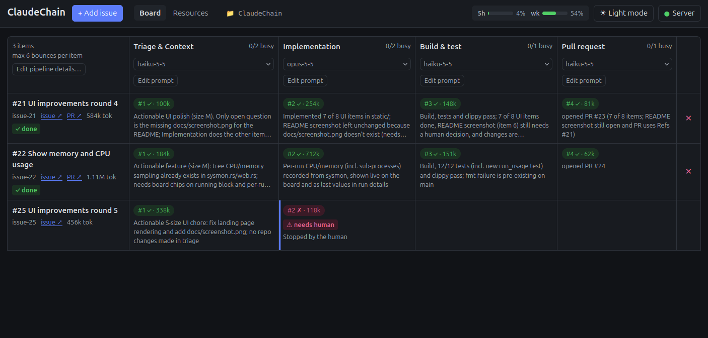

# ClaudeChain

A local web app that runs GitHub issues through a pipeline of Claude Code
agents, by default Triage & Context → Implementation → Build & test → Pull
request. Each step has its own prompt, model and worker limit, and steps can be
added from a list of preset stages in the pipeline editor. Agents talk
only through files, and each one decides where the work goes next: forward,
back to an earlier step, or to you.



## Requirements

- Rust, `git`, and `gh` (logged in).
- The [Claude Code](https://claude.com/claude-code) `claude` CLI, logged in.
  Agents always use this login (`ANTHROPIC_*` environment variables are
  removed), so with a subscription, runs count against your plan. Costs shown
  in the UI are API-equivalent estimates.

## Running

```bash
cargo run --release
```

Open http://127.0.0.1:7878 and pick a repository. By default its pipeline, prompts
and items are stored in `<repo>/.claudechain`, which is added to
`.git/info/exclude`. Recent repositories are remembered in
`~/.config/claudechain/state.json`.

Options: `--repo <path>`, `--data <dir>`, `--port`, `--host`, `--claude <path>`.

## Using it

- **+ Add issue**: a GitHub issue URL, `#123`, or plain text.
- **Pipeline**: add, reorder and configure steps (model, workers, approval,
  permission mode, tools, allowed transitions). Column headers edit each step's prompt. Setting
  workers to 0 pauses a step.
- **Click a cell** to inspect a run: live transcript, exact input, output files
  and the branch diff. From there you can message a running agent, continue a
  finished run, leave a note for the next run, or stop, retry, move or remove
  the item.
- **Resources**: plan usage and limits, an auto-pause threshold, token usage,
  and system load (Linux only).

## How it works

```
<repo>/.claudechain/
  pipeline.toml        steps and their settings
  prompts/             general.md plus one prompt per step
  items/<id>/          issue.md, item.json, messages/, runs/
  worktrees/<id>/      git worktree on branch claudechain/<id>
```

Each run starts `claude -p` in the item's worktree with the step's permission
mode (default `dontAsk`) and only the step's tools, without loading your own
MCP servers. The agent writes a
message and a `transition.json` (`{"to": "next" | "<step id>" | "human", ...}`),
and ClaudeChain moves the item. A missing transition, a stop, or too many
backward moves (`max_iterations`) hands the item to you. Agents stop with
ClaudeChain and are requeued on the next start.

By default the server listens on localhost only. It rejects non-local Host headers and
requires an `x-claudechain` header on changes, so other websites can't drive
it from your browser.
